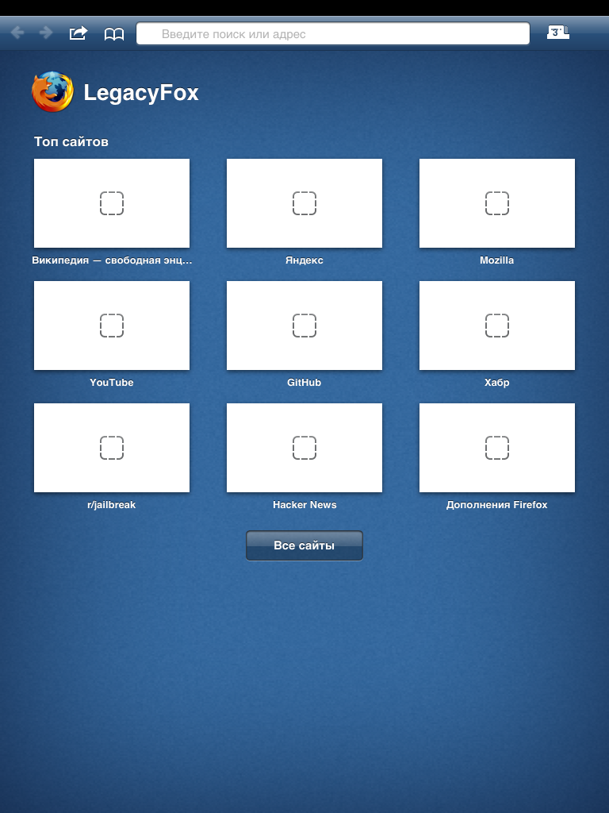
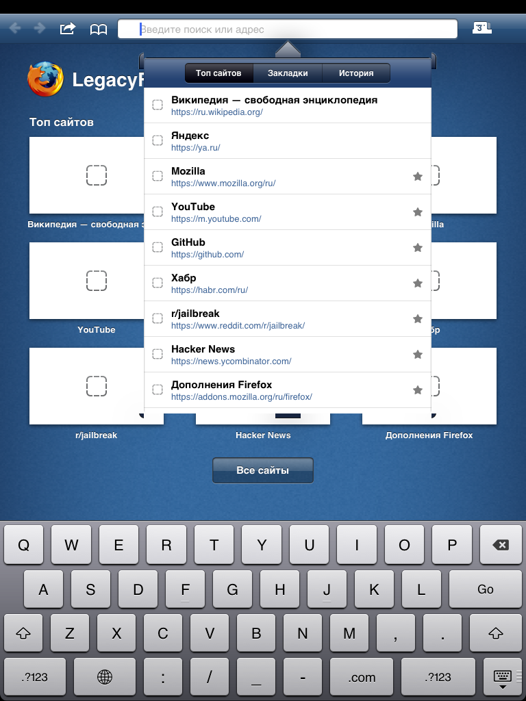
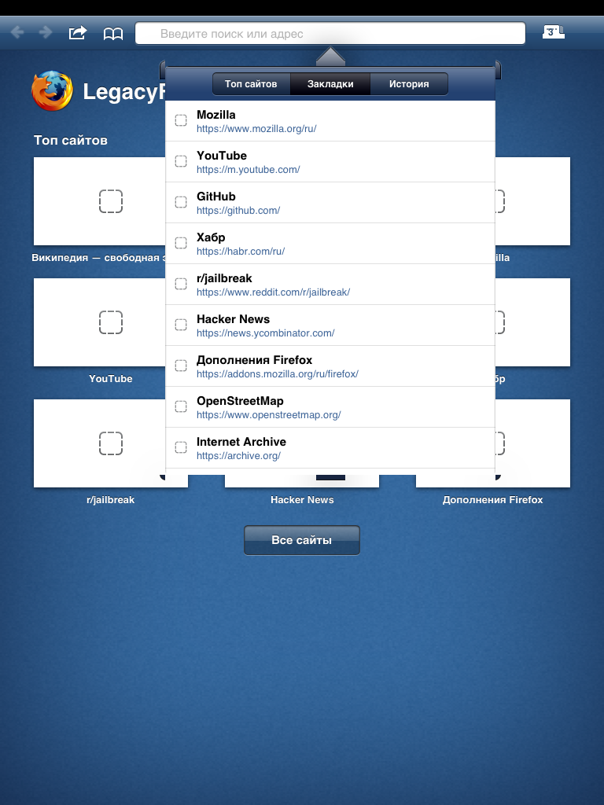
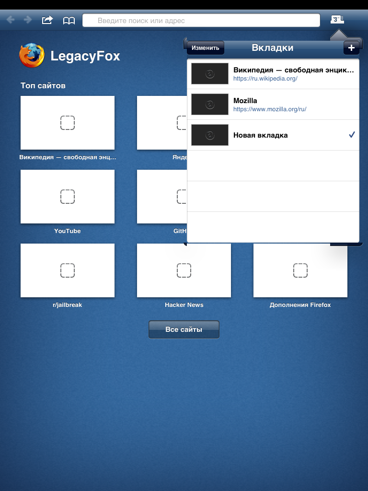
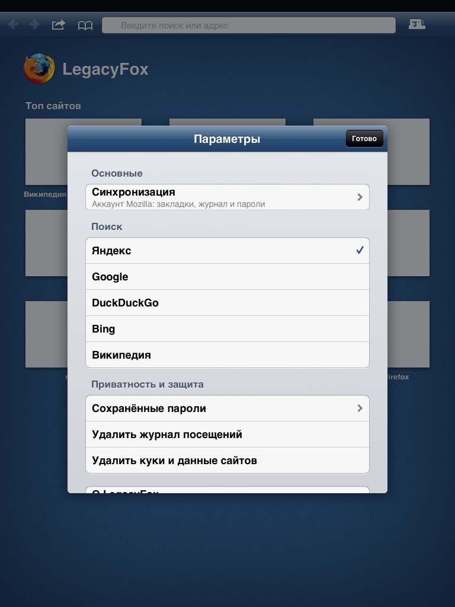

# LegacyFox

> **⚠️ Нестабильная бета-версия (1.0.0~beta1).** Возможны вылеты, зависания и
> долгая загрузка тяжёлых сайтов.

Браузер на движке Firefox (Gecko 153 ESR) для джейлбрейкнутых iPhone, iPad и
iPod touch на **iOS 5–7** с процессорами **A4–A6** и **512 МБ** памяти: не
системный UIWebView, а настоящий Gecko, собранный под armv7. Интерфейс сделан
так, как мог бы выглядеть Firefox для iOS 6: синие панели Firefox Home
(iOS-приложения Mozilla 2010–2012 годов) и системные элементы iOS.
Разработчик — **LegacyReborn Project**.

Установка: Cydia-репозиторий http://repo.legacyreborn.cfd/ или `.deb` из
[Releases](https://github.com/LR-Vensuki/LegacyFox/releases).



| Поиск из адресной строки | Закладки | Вкладки | Настройки |
|---|---|---|---|
|  |  |  |  |

## Что есть

- Вкладки с миниатюрами; фоновые выгружаются из памяти и возвращаются с историей.
- Топ сайтов, закладки и история (Places), поиск из адресной строки.
- Аккаунт Mozilla и синхронизация закладок, истории и паролей.
- Пароли, загрузки, поиск по странице, полная версия сайта, приватные вкладки.
- JIT (Baseline и Ion), WebAssembly, видео H.264 через VideoToolbox.

Проверено на iPad 2 с iOS 6.1.3. Вариант для iPhone на живом iPhone ещё не проверен.

## Устройство

```
shell/        оболочка на UIKit (Objective-C, MRC), iOS 4+, armv7
patches/      изменения Gecko поверх FIREFOX_153_4_0esr_RELEASE (engine/release.txt)
mozconfig/    конфигурация сборки движка под armv7-apple-ios
prefs/        настройки движка под 512 МБ
compat/       то, чего нет в iOS 4–7 (clock_gettime, *at-вызовы и др.)
sdk-overlay/  заголовки, которых нет в iOS 6.1 SDK
tools/        тулчейн (Rust-таргет, libc++), сборка, отладка на устройстве,
              tools/fennec-ui — ресурсы интерфейса из исходников Mozilla
layout/       файлы пакета для Cydia
```

## Сборка

Нужны [Theos](https://theos.dev), `iPhoneOS6.1.sdk` в `$THEOS/sdks`, clang 21 и
около 35 ГБ на диске.

```bash
tools/setup-toolchain.sh      # Rust-таргет, libc++, кэши
# исходники Firefox 153.4 ESR в engine/firefox, затем:
git -C engine/firefox am ../../patches/ios-armv7/*.patch
tools/mach.sh build           # движок
make package                  # packages/*.deb
```

Подход к оптимизации взят у
[gecko-w10m](https://github.com/Computershik73/gecko-w10m): один процесс, свой
Rust-таргет, software WebRender, ужатые лимиты памяти.

## Лицензия

Изменения движка и оболочка — MPL-2.0, как сам Gecko. Изображения интерфейса
взяты из исходников Firefox для Android и Firefox Home для iOS (Mozilla,
MPL), галочки — Material Icons (Google, Apache 2.0), см.
[tools/fennec-ui/README.md](tools/fennec-ui/README.md).

LegacyFox — неофициальная сборка, она не связана с Mozilla. Firefox и логотип
Firefox — товарные знаки Mozilla Foundation.
